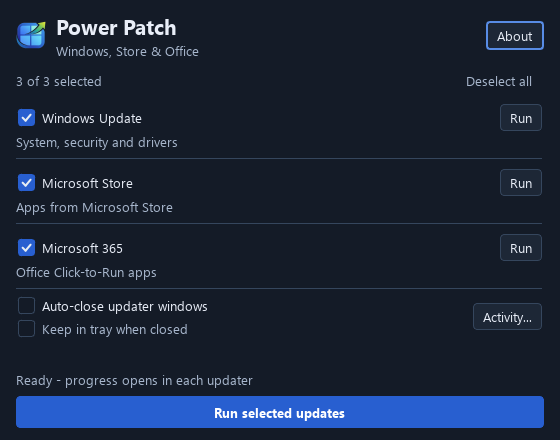

# User guide

Power Patch is a native Windows desktop app that starts Windows, Microsoft Store, and Microsoft 365 update checks from one compact panel.

Power Patch requests updates; it does not confirm that updates were downloaded or installed. Follow progress and verify completion in each updater.

## Requirements

- Windows 11 x64. The project was originally developed on Windows 11 25H2.
- Microsoft Store installed and enabled for Store updates.
- A local Microsoft 365 Apps / Office Click-to-Run installation for Office updates.
- Access to the relevant updaters under your device's service and management policies.

## Use the panel

1. Launch Power Patch. From a source build, use `scripts\run\run_release.bat` after building; it supplies the Qt runtime path. For a packaged build, launch its `powerpatch.exe` with the supplied runtime files alongside it.
2. Check the sources to include in a batch. **Select all / Deselect all** changes all three selections together.
3. Click **Run selected updates**, or press **Ctrl+Enter**. A batch runs in Windows, Store, then Office order. Each source's **Run** button works independently of the batch selection.
4. Read the result below each source. Long results shorten to one line; hover to read the full message. Results remain available after restarting.
5. Use **Activity...** to open the current session's timestamped log. **Copy activity** becomes available when there is text to copy. An empty log at startup is normal, even when the main panel shows results from previous sessions.

During a run, update buttons, source selections, and the auto-close preference are locked. The progress bar counts finished launch attempts, not installed updates, and disappears when the run finishes. **Stop queued** skips sources that have not started. It does not cancel the current operation, downloads, or installations.

The default window is 560 x 440 logical pixels. The two preferences are always on the main panel. Run and Stop stay outside the scrolling source area. On narrow windows, controls rearrange; very short windows may need vertical scrolling. Light and dark appearance follow the application palette. Saved window geometry is fitted to the available screen when the app starts.

## Preferences and closing

| Preference | Behavior |
| --- | --- |
| Auto-close updater windows | Closes Windows Settings after a scan request and Store after an update action is invoked. Office waits for its UI-based completion check. Windows needing manual action remain open. Default: off. |
| Keep in tray when closed | Closing the main window hides it and Activity, while any active batch continues. Use the tray menu's **Open Power Patch**, **Run selected updates**, or **Exit**. Default: off; unavailable when the session has no system tray. |

Preference changes appear immediately and are saved in the background after a short delay. Normal close waits for pending preference writes.

With tray behavior off, closing during a run skips pending sources and waits for the current operation before exiting. Tray **Exit** behaves the same way. An Office completion check can take up to approximately 30 minutes with auto-close enabled; Power Patch remains responsive while it waits.

### Launching again

Launching the same executable again force-closes its older instances in the current Windows session, including tray instances, and opens a fresh window. Concurrent launches are serialized. Copies at different executable paths and processes in other sessions are not replaced.

This is a forced restart: the old instance's unfinished launch sequence stops, its in-memory activity is lost, and preferences still waiting to save may be lost. Windows, Store, and Office updaters already launched are not terminated. If an existing instance cannot be inspected or stopped, startup shows an error instead of opening another dashboard.

## Settings and activity

- Current settings: `%LOCALAPPDATA%\Power Patch\Power Patch\settings.ini`.
- Stores source selections, both preferences, window geometry, and the latest result for each source.
- Imports recognized boolean preferences from `settings.ini` beside the executable once, without replacing existing new-format preferences.
- Activity is session-only, limited to 200 entries, and is not written to a separate log file. Copy it before closing if you need to keep it.
- The first launch after the compact-layout redesign resets the old oversized window geometry once.

To reset preferences, exit Power Patch completely, back up and remove the current settings file, then relaunch. A remaining legacy file beside the executable will be imported again. The standalone wrapper's settings-preservation limitation is documented in [packaging and versioning](standalone-versioning.md).

## Results and troubleshooting

| Result or symptom | Meaning / next step |
| --- | --- |
| Requested | The updater or scan request was launched. Check that updater for installation progress. |
| Action needed | The updater opened, but automatic action or Office completion could not be confirmed. Read the full message and continue in the updater. |
| Unavailable | A required installation, protocol, service, or policy condition prevents launching. Enable/install it or contact your administrator. |
| Failed | Launching failed. Read the source result or copy Activity for troubleshooting. |
| Skipped | The source was queued but stopped before launch. Its Run button can retry it. |
| Preference-save warning | The current settings location could not be written. Check its permissions and available storage. |
| Could not restart | An older instance could not be inspected/stopped, or startup lock acquisition timed out. Close that instance manually and retry. |
| Window remains open after closing | An active launch is finishing, or tray behavior is enabled. Check the status text or tray menu. |

Store automation depends on the Store UI and may require manual intervention if the interface changes. Windows Update scan commands can be ignored or constrained by device management. Office completion detection observes its UI; it is not a guarantee that Office installed an update successfully. Other Office installation types need their own updater.

## Further documentation

- [Development setup](dev-environment.md)
- [Testing](update-flow-checks.md)
- [Packaging and versioning](standalone-versioning.md)
- [Architecture](architecture.md)
